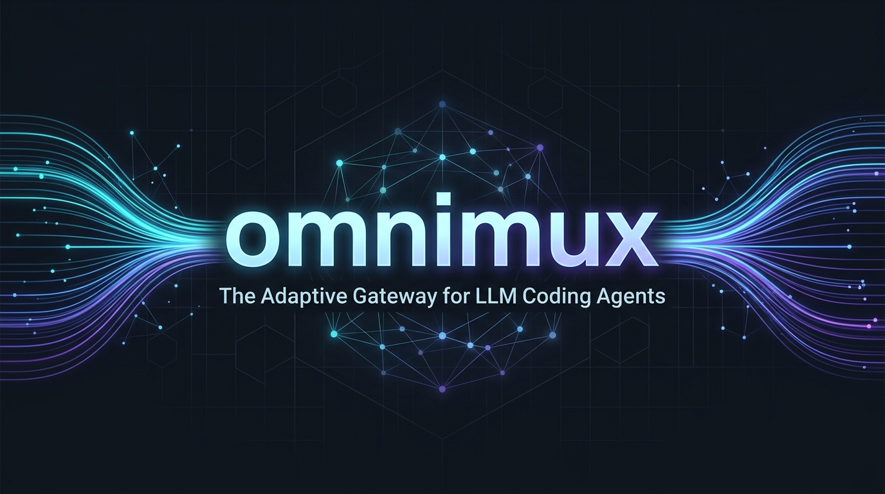

<p align="center">
  
</p>

<p align="center">
  <strong>The adaptive local multiplexer and fallback gateway for LLM coding agents.</strong><br>
  One endpoint. Any agent. Zero downtime.
</p>

<p align="center">
  <a href="https://pypi.org/project/omnimux/"></a>
  <a href="https://python.org"></a>
  <a href="https://github.com/lucikritz/nexus-llm/actions"></a>
  <a href="LICENSE"></a>
</p>

---

## What is omnimux?

When coding agents (Claude Code, Cursor, RooCode, Continue, Open WebUI, Aider) hit rate limits (`429`), credit exhaustion (`402`), or local VRAM out-of-memory errors, tasks break mid-refactor.

**omnimux** is a lightweight, database-first local gateway that sits between your coding tools and your LLM backends. It translates between OpenAI and Anthropic protocols, multiplexes API keys across providers, automatically hot-swaps to fallbacks upon failure, and unloads idle local models before loading new ones.

```
Coding Agents (Claude Code, Cursor, RooCode, Continue, Aider)
                              │
                    [ omnimux gateway ]
                              │
   ┌───────────────┬──────────┴────────┬─────────────┬──────────┐
   ▼               ▼                   ▼             ▼          ▼
Anthropic      OpenRouter            Gemini         Groq      Ollama
(Claude 3.5)   (Failover pool)     (Long context) (Fast)   (Local zero-OOM)
```

---

## Compatible Extensions & Agents

omnimux exposes standard OpenAI (`/v1/chat/completions`) and Anthropic (`/v1/messages`) endpoints, making it a drop-in replacement across tools:

| Agent / Tool | Protocol | Configuration |
| :--- | :--- | :--- |
| **Claude Code** | Native Anthropic (`/v1/messages`) | `export ANTHROPIC_BASE_URL="http://localhost:11444"`<br>`export ANTHROPIC_API_KEY="om_your_client_token"` |
| **Cursor** | OpenAI Compatible (`/v1`) | Base URL: `http://localhost:11444/v1`<br>API Key: `om_your_client_token` |
| **RooCode / Cline** | OpenAI / Anthropic format | Base URL: `http://localhost:11444/v1` or Anthropic Base URL |
| **Continue.dev** | OpenAI / Anthropic format | `apiBase: "http://localhost:11444/v1"` in `config.yaml` |
| **Open WebUI** | OpenAI Compatible (`/v1`) | Connections &rarr; OpenAI API: `http://localhost:11444/v1` |
| **Aider** | OpenAI Compatible (`/v1`) | `export OPENAI_API_BASE="http://localhost:11444/v1"`<br>`export OPENAI_API_KEY="om_your_client_token"` |

---

## Core Features

- 🔄 **Autonomous 429 Hot-Swapping**: Automatically cycles through backup API keys and provider fallbacks with intelligent backoff cooldowns when an upstream service rate-limits or fails.
- 🦙 **Zero-OOM Ollama Engine**: Issues `keep_alive: 0` unloads for idle local models prior to spinning up fresh models, preventing out-of-memory crashes on unified-memory Apple Silicon and CUDA GPUs.
- ⚡ **Dual Protocol Translation**: Complete bidirectional translation between Anthropic `/v1/messages` and OpenAI `/v1/chat/completions` with full SSE streaming and token count endpoints.
- 🗜️ **Context Optimizer**: Converts bulky HTML pages from agent web searches into lean markdown and deduplicates multimodal vision images with local SHA-256 caching.
- 🔐 **Scoped Client Keys**: Generate isolated client tokens (`om_...`) per IDE extension with local database tracking, usage timestamps, and instant revocation.
- 📦 **Daemon & Single-Binary Simplicity**: Run seamlessly as a background service via `omnimux start -d` or inspect active logs with `omnimux status`.

---

## Quickstart

### 1. Installation

Run via `uvx` (no installation required) or install with `pip`/`uv`:

```bash
# Run immediately via uvx
uvx omnimux --help

# Or install globally into your environment
uv pip install omnimux
```

*(Note: `omni`, `nexus`, and `nexus-llm` are registered aliases for all CLI commands.)*

### 2. Discover & Register Models

Interactively discover and register models from local Ollama or upstream providers:

```bash
omnimux model add
```

### 3. Start the Gateway

```bash
# Start in the foreground
omnimux start --port 11444

# Or start as a background daemon
omnimux start -d --port 11444

# Check status or stop
omnimux status
omnimux stop
```

### 4. Create an Agent Token

Create an isolated client key for your coding agent:

```bash
omnimux keys create claude-code
# Output: om_k9A2x...
```

Then point your agent:

```bash
export ANTHROPIC_BASE_URL="http://localhost:11444"
export ANTHROPIC_API_KEY="om_k9A2x..."
claude
```

---

## CLI Reference

| Command | Description |
| :--- | :--- |
| `omnimux start [--port PORT] [-d]` | Start the gateway server (foreground or daemon) |
| `omnimux stop` | Terminate running daemon process |
| `omnimux status` | Inspect health, PID, and port of running daemon |
| `omnimux model add` | Interactively query and register upstream models |
| `omnimux model list` | List registered platform models and endpoints |
| `omnimux keys create [name]` | Generate a client API token (`om_...`) |
| `omnimux keys list` | List active client keys and last used timestamps |
| `omnimux keys revoke <id>` | Revoke a client key |
| `omnimux export <file.json>` | Export entire SQLite routing state to JSON |
| `omnimux cache --clear` | Purge local image and request cache |

---

## Configuration

Settings can be overridden via environment variables or a local `.env` file:

```env
PORT=11444
SQLITE_DB_PATH=omnimux_state.db
PROXY_PASSWORD=optional_fallback_password
```

Legacy `nx_...` keys and existing SQLite states are automatically recognized and supported for backwards compatibility.

---

## License

MIT &copy; LuciKritZ
